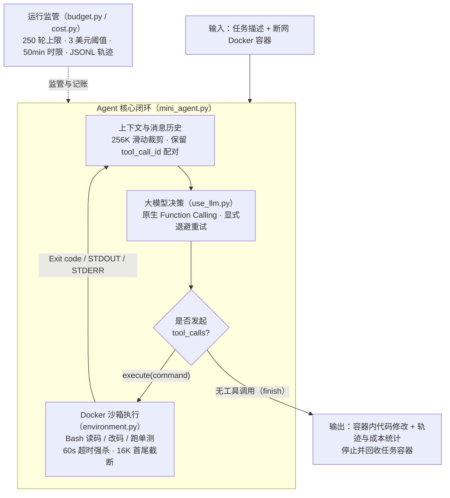

# mini-swe-agent

基于原生函数调用（Function Calling）和 Docker 隔离沙箱的轻量级代码修复智能体（Agent）。  
参考 [mini-SWE-agent](https://github.com/SWE-agent/mini-swe-agent) 架构，核心运行仅依赖 `openai` 与 `python-dotenv`。模型在隔离容器内通过 Bash 读取代码、修改文件并运行测试，程序负责上下文裁剪、超时与费用控制、瞬时网络故障重试及运行轨迹记录。

入口：[核心能力](#核心能力) · [评测基线](#评测基线) · [快速开始](#快速开始) · [单元测试](#单元测试)

## 核心能力

- **原生 Tool-Use 循环与上下文控制**：通过单一 `execute` 工具提交容器内 Bash 命令，将退出码、STDOUT 与 STDERR 写回关联 `tool_call_id` 的 `tool` 消息驱动多轮排错。单次命令输出经临时文件首尾采样截断至 16,000 字符（防止单次大日志占用过多内存与上下文），工具历史按 256,000 字符滑动裁剪并保留调用配对完整性。
- **沙箱隔离与预算控制**：容器启用 `--network none` 与 CPU/内存限额，单条命令由容器内 `timeout --signal=KILL` 限制（默认 60 秒）；`budget.py` 通过独立工作子进程配合单调时钟监管整体时限（50 分钟）、轮数上限（250 轮）和费用阈值（3 美元），原子写入结果并在结束或异常时强制停止容器。
- **显式故障重试与透明记账**：关闭 SDK 内部重试（`max_retries=0`），在调用层针对连接重置、超时、429 与 5xx 瞬时故障执行最多 3 次指数退避重试（`1s → 2s → 4s`）。所有请求、重试、模型回复与工具输出逐行写入 `trajectory.jsonl`，超时或中断后仍可从轨迹恢复已知词元与费用。



## 评测基线

在 [scaleapi/SWE-bench_Pro-os](https://github.com/scaleapi/SWE-bench_Pro-os) 全量 642 题上完成基线验证（`deepseek-flash` 关闭思考，8 并发），完整明细见 [2026-11-15 全量评测报告](https://github.com/DeianHsu/mini-swe-agent/blob/master/reports/43650570228/report.md)。

| 指标 | 实测结果 |
| --- | --- |
| 首次尝试通过率（pass@1） | **87.38%**（**561 / 642** 题通过） |
| 单题平均用时 / 平均轮数 | **3 分 56 秒** / **32.01 轮**（共 20,553 次请求） |
| Prompt Cache 命中率 | **97.34%**（527.6M / 542.0M 输入词元） |
| 完整样本平均费用 | 约 **0.02 美元/题**（已记录总费用 12.639 美元） |

> 评测复盘：全量 2 万余次请求中出现 3 例对端连接重置（`Connection reset by peer`），随后在 `use_llm.py` 调用层补充了针对瞬时故障的显式指数退避重试与 `retry` 轨迹审计。

## 项目结构

```text
src/swe/
├── mini_agent.py        # 智能体主循环、历史裁剪、工具调度与轨迹记录
├── environment.py       # Docker 容器 Bash 执行、超时强杀与首尾采样截断
├── use_llm.py           # OpenAI SDK 封装、原生函数调用与显式退避重试
├── budget.py            # 子进程时限监管、原子落盘、容器停止与用量恢复
└── cost.py              # 词元与美元费用统计、轨迹断点用量恢复
evaluation/              # SWE-bench Pro V2 判分校准、全量调度与报告汇总
tests/                   # 离线单元测试
.github/workflows/       # GitHub Actions 校准与全量评测工作流
```

## 安装与配置

需要 **Python 3.14+**、**uv** 与运行中的 Docker Linux 引擎（Windows 可用 Docker Desktop）。

```powershell
uv sync
```

在项目根目录创建 `.env`：

```dotenv
DEEPSEEK_API_KEY=你的密钥
DEEPSEEK_BASE_URL=https://api.deepseek.com
DEEPSEEK_MODEL=deepseek-flash
```

## 快速开始

以下命令在项目根目录 PowerShell 中执行。

1. 启动断网且限额的目标容器（将待修复代码放入 `/workspace`）：

```powershell
docker run -d --name mini-swe-sandbox --network none --cpus 1 --memory 4g -w /workspace python:3.14-slim sleep infinity
```

2. 将问题描述写入 UTF-8 文件 `task.md`，通过预算监管入口启动智能体（可用 `--thinking-mode max` 开启最高思考档）：

```powershell
uv run python -m swe.budget --task-file task.md --container mini-swe-sandbox --workdir /workspace --output "archive/manual/$(Get-Date -Format yyyyMMdd-HHmmss)"
```

运行结果保存在指定输出目录：
- `case.json`：任务、预算配置与思考模式；
- `trajectory.jsonl`：逐轮请求、重试、模型回复及工具执行轨迹；
- `agent_result.json`：用时、轮数、词元、估算费用与结束原因；
- `agent.log`：运行日志。

## 单元测试

离线运行，不调用外部模型接口，也不启动真实评测容器：

```powershell
uv run python -m unittest discover -s tests -v
uv run python -m unittest discover -s evaluation -v
```

<details>
<summary>独立评测流水线（GitHub Actions 校准与全量评测，点击展开）</summary>

[评测代码](https://github.com/DeianHsu/mini-swe-agent/tree/master/evaluation)与 Agent 主线通过命令行和 JSON 产物解耦，工作流配置保存在 [.github/workflows/](https://github.com/DeianHsu/mini-swe-agent/tree/master/.github/workflows)：

- **[判分校准](https://github.com/DeianHsu/mini-swe-agent/actions/workflows/evaluate_calibration.yml)**：验证单题空补丁失败、参考补丁通过（0 次模型调用）。
- **[全量评测（默认关闭思考）](https://github.com/DeianHsu/mini-swe-agent/actions/workflows/evaluate_all.yml)**：3 批次共 642 题，每题在全新容器中独立判分并汇总成本报告。
- **[全量评测（最高思考）](https://github.com/DeianHsu/mini-swe-agent/actions/workflows/evaluate_all_max.yml)**：启用 `thinking.type=enabled` 与 `reasoning_effort=max`，沿用相同题目与预算配置。

</details>

本地 `archive/`、`.env`、虚拟环境和编辑器配置均不纳入版本控制。
